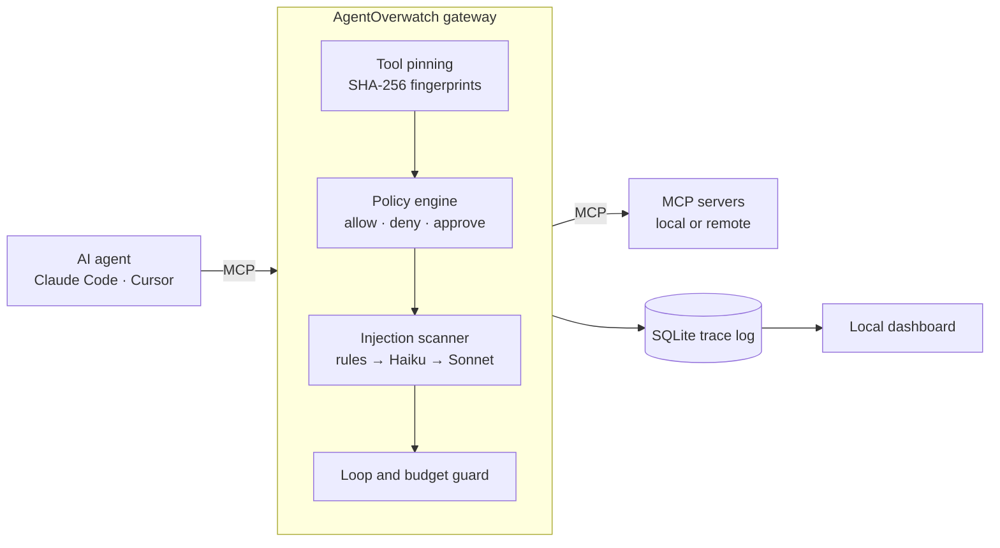

<!--
  Achyuta M | AI Engineer | Agentic AI | Forward Deployed Engineer | LLM system design, AI agents, MCP, evals, LLM observability, AI agent security
-->

# Achyuta M · AI Engineer

**I design and ship production agentic AI systems: AI agents, MCP tool integrations, evals, guardrails and LLM observability.**

AI Developer at **Cognizant**, building generative AI and agentic workflows for enterprise healthcare and life sciences teams. I work the forward deployed way: sit with the team that has the problem, design the system around their real data and constraints, ship it, measure it with evals, and keep it running.

Open to **AI Engineer**, **Agentic AI Engineer** and **Forward Deployed Engineer (FDE)** roles · remote or on-site · India, US, Europe, UAE.

---

## What I build

| Area | What that means in practice |
|---|---|
| **Agentic AI** | Tool-using AI agents, multi-step and multi-agent workflows, human-in-the-loop approvals, Claude Agent SDK |
| **Model Context Protocol (MCP)** | MCP servers and clients, stdio and Streamable HTTP transports, tool design and tool security |
| **LLM system design** | Model routing (fast model first, stronger model when unsure), latency and cost budgets, fail-closed defaults, caching |
| **RAG and context engineering** | Chunking, embeddings, hybrid search, re-ranking, keeping the context window small and relevant |
| **Evals** | Golden test sets, outside benchmarks, LLM-as-judge, false-positive tracking, eval gates in CI |
| **Guardrails and AI security** | Prompt-injection detection, tool poisoning protection, policy enforcement, automated LLM red teaming |
| **LLMOps and observability** | Full request and tool-call tracing, token and cost tracking, loop and budget limits, dashboards |
| **Production engineering** | TypeScript, Node.js, Python, FastAPI, React, SQLite, Docker, AWS (ECS/Fargate, S3), GitHub Actions |

---

## Featured project

### 🛡️ [AgentOverwatch](https://github.com/Achyuta2605/AgentOverwatch): a security and observability gateway for AI agents

AI coding agents like Claude Code and Cursor now call dozens of third-party MCP tools on their own. Any tool can change its description to smuggle in instructions, return output with a hidden prompt injection, or trap the agent in a loop that burns money. AgentOverwatch sits between the agent and every tool call.

**System design decisions**

- **Tiered detection for latency and cost:** fast local rules run on every tool output in under a millisecond; only suspicious cases go to Claude Haiku, and only uncertain ones escalate to Claude Sonnet. Most calls never pay for an LLM.
- **Fail closed:** a changed tool is hidden until a person approves it, and an invalid policy stops the gateway from starting instead of running unprotected.
- **Human in the loop:** risky tools and runaway loops pause for approval instead of silently killing the agent's task.
- **Transparent proxy:** about 0.4 ms added per call (p50), so the agent and server behave exactly as before.

**Measured with evals, not vibes**

- 100% of its own prompt-injection test set blocked in full mode, with **0 false blocks** on tricky normal outputs
- 79% blocked on Microsoft's **BIPIA** benchmark, an outside test set it was not built on
- Nightly automated red team: Claude writes about 30 fresh attacks each night and the scanner is measured on them
- 98 tests, CI on Linux and macOS

`TypeScript` `MCP SDK` `Claude API` `Agentic AI` `Evals` `Guardrails` `SQLite` `Hono` `React` `Vitest` `GitHub Actions`

---

## More projects

**🧪 [AMRDrugX](https://github.com/Achyuta2605/AMRDrugX): a multi-model AI pipeline on AWS.** Chains a deep learning interaction model (DeepPurpose), binding-site prediction (P2Rank), docking (AutoDock Vina) and interaction analysis (PLIP) into one workflow, with each stage as a containerised worker on AWS ECS/Fargate, results in S3, a FastAPI backend and an Angular console.
`Python` `FastAPI` `AWS ECS/Fargate` `S3` `Docker` `Angular`

**👁️ [YOLOv8 segmentation web app](https://github.com/Achyuta2605/yolov8-webapp): computer vision in production.** A custom-trained YOLOv8 segmentation model served in a Streamlit app that scores how much of a leaf is diseased.
`Python` `YOLOv8` `OpenCV` `Streamlit`

---

## I explain AI systems in public

I run a LinkedIn video series, **"10 problems companies face adopting AI"**: data readiness, legacy systems, inference cost, ROI, trust and explainability, each with how real engineering teams solve it.

➡️ [Follow on LinkedIn](https://www.linkedin.com/in/achyuta-m-51b823224/)

---

## Quick facts

- **Who:** Achyuta M, AI Engineer
- **Current role:** AI Developer at Cognizant, building generative and agentic AI for enterprise healthcare and life sciences teams
- **Looking for:** AI Engineer, Agentic AI Engineer, Forward Deployed Engineer
- **Core skills:** agentic AI, AI agents, LLM system design, MCP, RAG, context engineering, evals, guardrails, LLM observability, Python, TypeScript
- **Flagship project:** AgentOverwatch, an open-source (Apache 2.0) security gateway for AI agents and MCP tools
- **Location:** Chennai, India · open to remote and relocation (US, Europe, UAE)

---

## Contact

- **LinkedIn:** [linkedin.com/in/achyuta-m-51b823224](https://www.linkedin.com/in/achyuta-m-51b823224/)
<!-- TODO: - **Email:** TODO -->
- **GitHub:** [@Achyuta2605](https://github.com/Achyuta2605)

Hiring for someone who can sit with a customer, design the agent system, and ship it to production? Let's talk.
